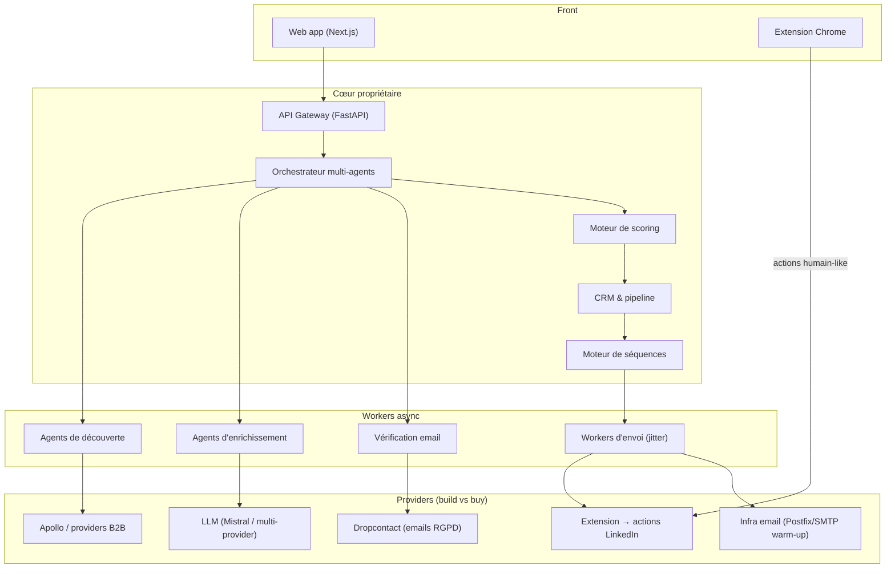
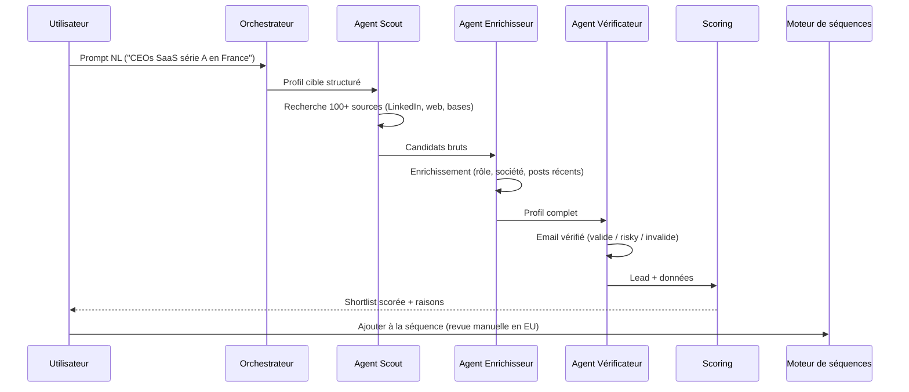
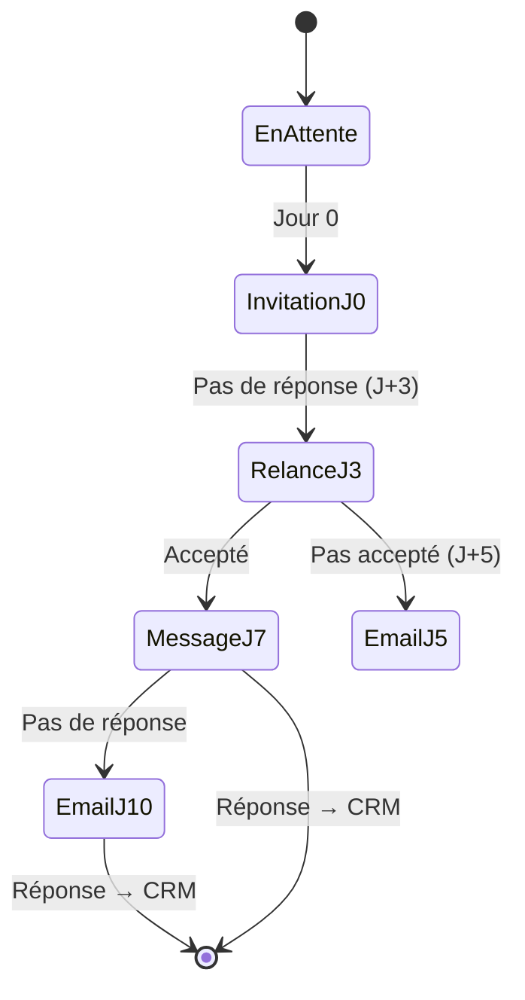
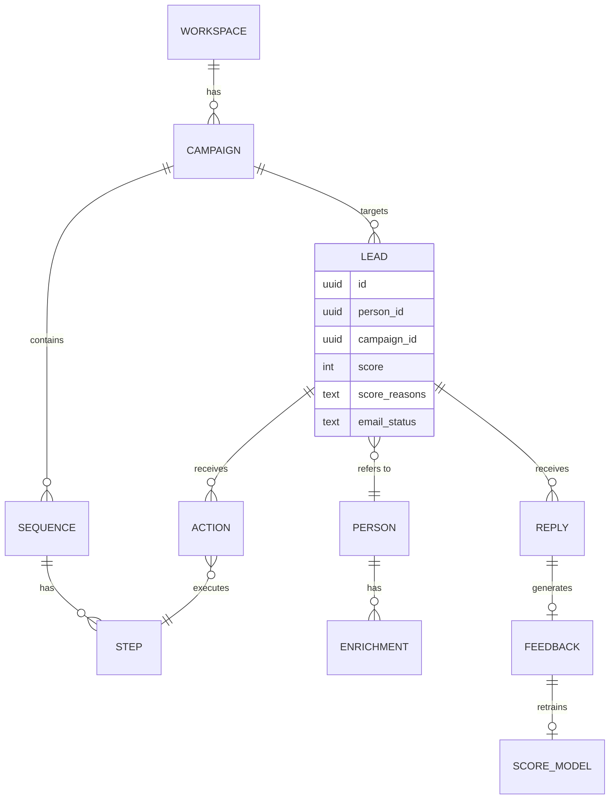
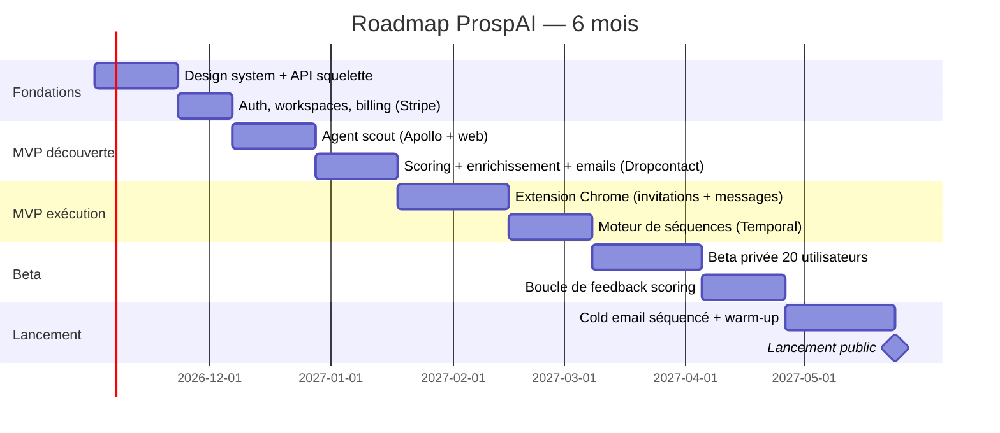

# ProspAI — Architecture technique & roadmap

## 1. Vue d'ensemble

Approche **mixte** : on construit le cœur (agents IA, moteur de séquences, scoring) et on connecte les providers existants pour les données (Apollo, Dropcontact) et le sending.

## 2. Stack recommandée

| Couche | Choix | Pourquoi |
|---|---|---|
| Front | Next.js + Tailwind + shadcn | Rapide, moderne, SEO landing |
| Extension Chrome | React + Manifest V3 | Actions LinkedIn côté client (comme Waalaxy) |
| API | Python FastAPI | Écosystème IA, async natif |
| Orchestrateur | Temporal (ou Celery) | Séquences fiables, retries, timers J+1/J+3 |
| Agents IA | Mistral API (abstraction multi-provider) | Coût/vitesse, flexibilité |
| DB | PostgreSQL + pgvector | CRM + recherche sémantique de leads |
| Cache/queues | Redis | Jobs, rate-limiting, jitter |
| Infra | Fly.io ou AWS eu-west-3 (UE) | RGPD : hébergement UE par défaut |
| Observabilité | Grafana + Sentry | Monitoring quotas/bans |

## 3. Pipeline de découverte (rôle des agents)

## 4. Moteur de séquences multicanal

- Chaque action passe par la **file avec jitter** (fenêtres horaires, délais aléatoires 30–90 s, quotas quotidiens).
- En mode EU, défaut : **revue manuelle** avant la première vague d'envois.

## 5. Modèle de données (extrait)

## 6. Roadmap (6 mois)

## 7. Make ou buy — arbitrages clés

| Brique | Décision | Raison |
|---|---|---|
| Données B2B | **Buy** (Apollo + 1 backup) | Coût scraping légal >> API |
| Emails vérifiés | **Buy** (Dropcontact, EU) | RGPD + qualité |
| Scoring + agents | **Build** | Le moat produit |
| Moteur de séquences | **Build** sur Temporal | Cœur différenciant |
| Actions LinkedIn | **Build** extension (pas d'API officielle) | Seule voie viable, comme Waalaxy |
| LLM | **Buy** avec abstraction | Multi-provider, contrôle des coûts |